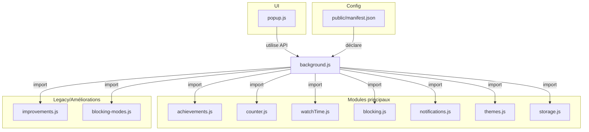

# 🗺️ ROADMAP YouTube Shorts Counter - 2025

Cette roadmap présente les 10 améliorations prioritaires identifiées pour transformer l'extensi## 📅 Timeline de Développement

### Phase 1 - Foundations (Semaines 1-6)

- [x] ✅ Système de Streaks (Implémenté)
- [ ] 🏆 Système d'Achievements
- [ ] ⏱️ Temps Moyen par Short
- [ ] 🎛️ Modes de Blocage Avancés
- [ ] 🎯 Système de Modes de Pause

### Phase 2 - Intelligence & Analytics (Semaines 7-12)

- [ ] 🔮 Analytics Prédictives
- [ ] 📊 Analytics Avancées
- [ ] 🔔 Notifications Intelligentes
- [ ] 💡 Alternatives Intelligentes

### Phase 3 - Personnalisation & UX (Semaines 13-18)

- [ ] 🎨 Thèmes Personnalisés
- [ ] 🏆 Système d'Objectifs
- [ ] ⏰ Contrôles Temporels
- [ ] 🎨 Thèmes Multiples

### Phase 4 - Connectivité & Social (Semaines 19-24)

- [ ] 🔄 Sync Multi-Appareils
- [ ] 👥 Fonctionnalités Sociales
- [ ] 🎯 Système de Motivationet de gestion des habitudes numériques.

## 🎯 Fonctionnalités Prioritaires

### 🏆 1. Système d'Achievements - Badges et récompenses
**Statut**: 🔄 En cours de développement  
**Impact**: ⭐⭐⭐⭐⭐ Motivation utilisateur  
**Complexité**: 🔧🔧 Moyenne

- Collection de badges pour différents accomplissements
- Système de notifications de déblocage
- Progression visuelle et récompenses

### ⏱️ 2. Temps Moyen par Short - Analytics de durée
**Statut**: 📋 Planifié  
**Impact**: ⭐⭐⭐⭐ Prise de conscience  

- Calcul automatique du temps moyen de visionnage
- Comparaison avec objectifs personnels
- Tendances et évolutions temporelles

### 🎛️ 3. Modes de Blocage Avancés - Doux/Strict/Adaptatif
**Statut**: 📋 Planifié  
**Impact**: ⭐⭐⭐⭐⭐ Contrôle utilisateur  

- **Doux**: Avertissement et suggestion d'alternatives
- **Standard**: Redirection immédiate (actuel)
- **Strict**: Délai de réflexion + confirmation
- **Adaptatif**: Ajustement selon l'historique personnel

### 🔮 4. Analytics Prédictives - Détection patterns
**Statut**: 📋 Planifié  
**Impact**: ⭐⭐⭐⭐ Intelligence  

- Détection des moments de vulnérabilité
- Alertes préventives personnalisées
- Prédictions basées sur l'historique

### 🎨 5. Thèmes Multiples - Personnalisation UI
**Statut**: 📋 Planifié  
**Impact**: ⭐⭐⭐ Expérience utilisateur  

- Mode sombre/clair
- Thèmes colorés personnalisés
- Mode minimaliste

### � 6. Sync Multi-Appareils - Chrome Sync API
**Statut**: 📋 Planifié  
**Impact**: ⭐⭐⭐⭐ Continuité  

- Synchronisation automatique entre appareils
- Backup cloud des données
- Profiles multiples (travail/personnel)

### 💡 7. Alternatives Intelligentes - Suggestions d'activités
**Statut**: 📋 Planifié  
**Impact**: ⭐⭐⭐⭐ Redirection positive  

- Activités physiques (marche, étirements)
- Contenu éducatif (articles, podcasts)
- Tâches productives (emails, todo list)

### 👥 8. Fonctionnalités Sociales - Partage et défis
**Statut**: 📋 Planifié  
**Impact**: ⭐⭐⭐ Communauté  

- Partage anonyme de statistiques
- Challenges entre amis
- Leaderboards communautaires

### ⏰ 9. Contrôles Temporels - Limites par horaires
**Statut**: 📋 Planifié  
**Impact**: ⭐⭐⭐⭐ Flexibilité  

- Limites différentes selon l'heure
- Blocage pendant heures de travail
- Paramètres week-end vs semaine

### 🎯 10. Système de Motivation - Gamification avancée
**Statut**: 📋 Planifié  
**Impact**: ⭐⭐⭐⭐⭐ Engagement long terme  

- Système de niveaux et XP
- Quêtes quotidiennes/hebdomadaires
- Récompenses virtuelles débloquables

## 🚀 Nouvelles Fonctionnalités Prioritaires

### 🎯 11. Système de Modes de Pause - Contrôle adaptatif
**Statut**: 📋 Planifié  
**Impact**: ⭐⭐⭐⭐⭐ Flexibilité utilisateur  
**Complexité**: 🔧🔧 Moyenne

- **Pause Totale**: Blocage complet des Shorts (mode actuel)
- **Pause Progressive**: Délai avant accès aux Shorts
- **Pause Intelligente**: Blocage selon contexte (heure, jour, streak)
- **Pause Motivante**: Défi/quête avant accès

### 🔔 12. Notifications Intelligentes - Engagement proactif
**Statut**: 📋 Planifié  
**Impact**: ⭐⭐⭐⭐ Motivation continue  
**Complexité**: 🔧🔧 Moyenne

- Notifications de félicitations pour les streaks
- Rappels motivants selon l'historique
- Alertes préventives avant risque de rechute
- Notifications de milestones et achievements

### 📊 13. Analytics Avancées - Insights détaillés
**Statut**: 📋 Planifié  
**Impact**: ⭐⭐⭐⭐ Prise de conscience  
**Complexité**: 🔧🔧🔧 Complexe

- Graphiques de tendances détaillés
- Comparaison avec moyennes communautaires
- Analyse des patterns comportementaux
- Rapport de productivité corrélé

### 🎨 14. Thèmes Personnalisés - Expérience visuelle
**Statut**: 📋 Planifié  
**Impact**: ⭐⭐⭐ Personnalisation  
**Complexité**: 🔧🔧 Moyenne

- Mode sombre/clair automatique
- Thèmes colorés (océan, forêt, minimaliste)
- Personnalisation des couleurs de progression
- Animations et transitions configurables

### 🏆 15. Système d'Objectifs - Défis personnalisés
**Statut**: 📋 Planifié  
**Impact**: ⭐⭐⭐⭐⭐ Motivation long terme  
**Complexité**: 🔧🔧🔧 Complexe

- Objectifs personnalisés (limite quotidienne, streak cible)
- Défis hebdomadaires et mensuels
- Progression vers objectifs avec récompenses
- Système de mentorship virtuel

## 📅 Timeline de Développement

### Phase 1 - Foundations (Semaines 1-4)
- [x] ✅ Système de Streaks (Implémenté)
- [ ] 🏆 Système d'Achievements
- [ ] ⏱️ Temps Moyen par Short
- [ ] 🎛️ Modes de Blocage Avancés

### Phase 2 - Intelligence (Semaines 5-8)
- [ ] 🔮 Analytics Prédictives
- [ ] 💡 Alternatives Intelligentes
- [ ] 🎨 Thèmes Multiples

### Phase 3 - Connectivité (Semaines 9-12)
- [ ] ⏰ Contrôles Temporels
- [ ] 🔄 Sync Multi-Appareils

### Phase 4 - Communauté (Semaines 13-16)
- [ ] � Fonctionnalités Sociales
- [ ] 🎯 Système de Motivation

## 🎯 Objectifs 2025

**Métriques Cibles**:
- Rétention: +50% après 30 jours
- Engagement: +200% interactions popup
- Efficacité: +75% utilisateurs atteignant objectifs
- Adoption: 10K+ utilisateurs actifs

**Prochaine Action**: Développer le 🏆 **Système d'Achievements** pour augmenter l'engagement utilisateur.

---

*Roadmap mise à jour le 9 juillet 2025*

### 🧠 Intelligence et Apprentissage

-   **IA et Suggestions**
    -   Suggestions automatiques de limites basées sur l'historique.
    -   Détection des patterns de consommation.
-   **Contenu Alternatif**
    -   Suggestions de vidéos longues ou de playlists éducatives après avoir atteint la limite.

### 🛡️ Protection et Sécurité

-   **Anti-Contournement**
    -   Détection des tentatives de désactivation.
    -   Mode "admin" avec mot de passe pour verrouiller les paramètres.
-   **Contrôle Parental**
    -   Interface administrateur pour les parents avec rapports par email.

---

## 🛠️ Plan d’action détaillé et découpage technique

### 1. Achievements & Analytics
- Modules : achievements.js, popup.js, chart.js, tests/achievements.test.js
- Actions : enrichir la structure, ajouter des badges, progression, tests, analytics visuelles

### 2. Modes de blocage adaptatifs
- Modules : blocking-modes.js, popup.js, background.js, tests/blocking-modes.test.js
- Actions : moteur de règles, UI de configuration, mode pause motivante, tests

### 3. Notifications intelligentes
- Modules : notifications.js (nouveau), background.js, tests/notifications.test.js
- Actions : centraliser l’envoi, personnaliser, anti-spam, triggers métiers

### 4. Thèmes & personnalisation
- Modules : themes.js (nouveau), popup.js, background.js, tests/themes.test.js
- Actions : structure de thèmes, sélecteur UI, application dynamique, tests d’UI

### 5. Synchronisation multi-appareils
- Modules : storage.js (nouveau), background.js, popup.js, tests/storage.test.js
- Actions : abstraction storage, gestion des conflits, migration, option UI

### Exemples d’API de modules

**notifications.js**
```js
export function sendNotification(type, context) { /* ... */ }
export function shouldNotify(type, context) { /* ... */ }
```

**themes.js**
```js
export const THEMES = { dark: {...}, light: {...}, ... };
export function applyTheme(themeName) { /* ... */ }
```

**storage.js**
```js
export function get(key, sync = false) { /* ... */ }
export function set(obj, sync = false) { /* ... */ }
```

### Schéma d’architecture (Mermaid)


